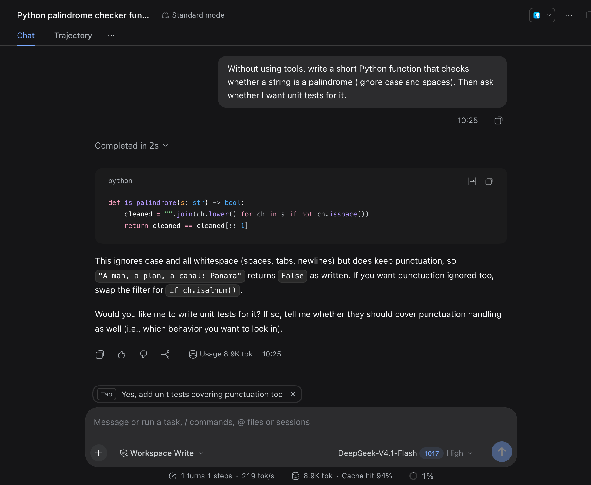
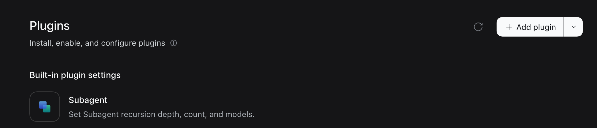
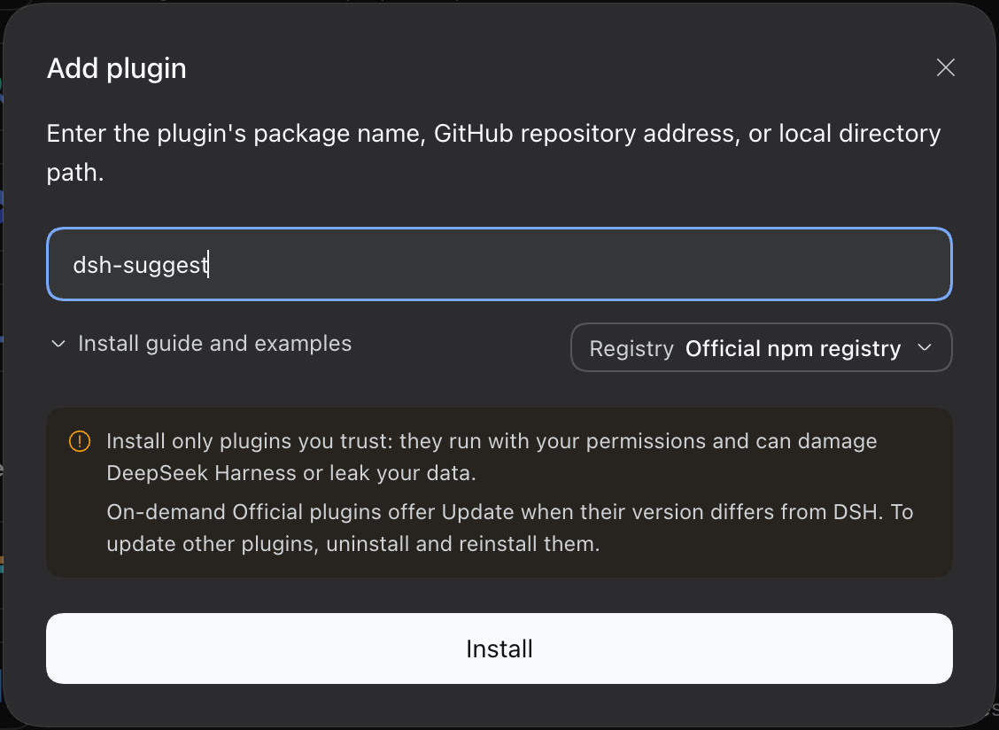
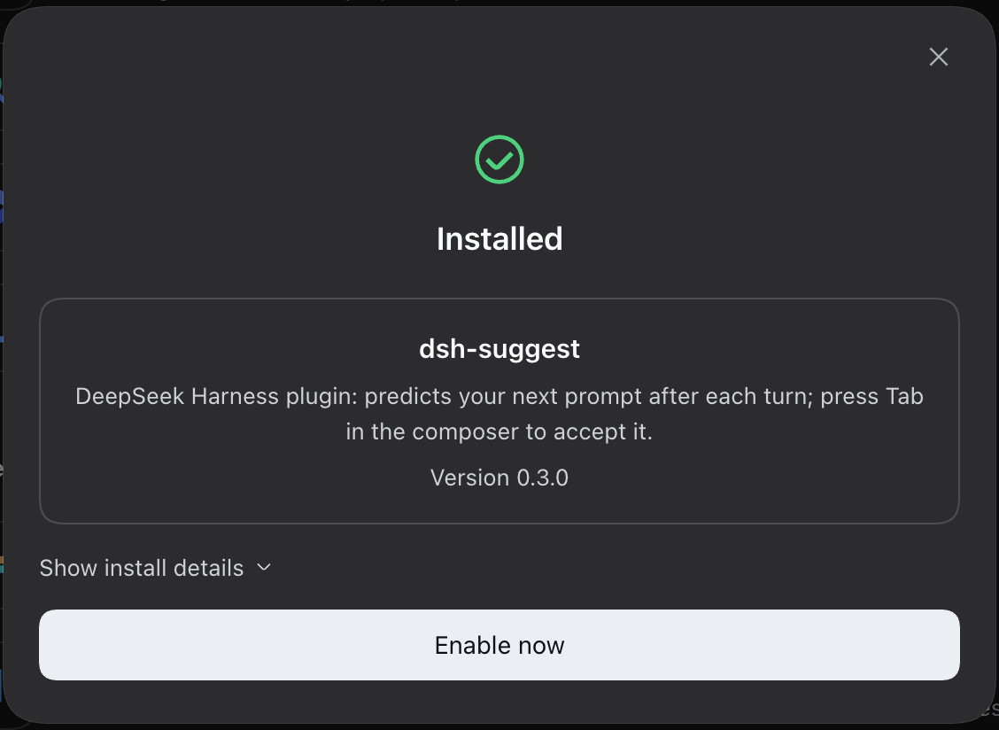
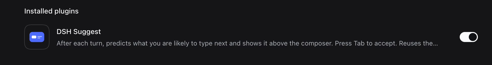
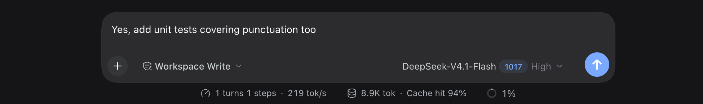
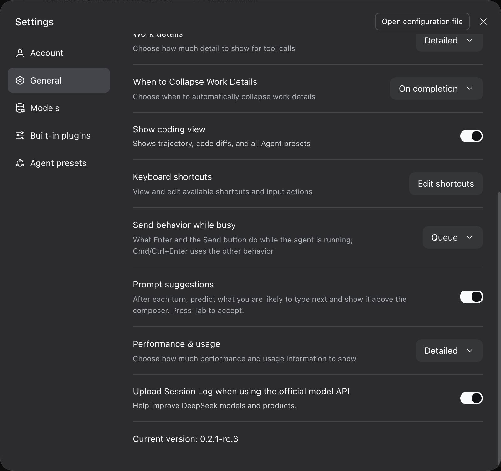

# dsh-suggest

[中文](README.md) | **English**

[](https://www.npmjs.com/package/dsh-suggest)

Next-prompt suggestions for DeepSeek Harness, similar to Claude Code's. After each turn, the plugin predicts what you are likely to type next and shows it above the composer. Press **Tab** to put it in the composer.



## Features

- After each turn, a predicted next prompt appears above the composer, such as "run the tests" or "Yes, add unit tests".
- Press **Tab** in the composer, or click the suggestion, to insert it into your draft. The insertion can be undone.
- Click the **×** on the right of the suggestion to dismiss it for this turn. Tab then behaves normally until the next turn ends.
- Turn the whole feature off in **Settings → General → Prompt suggestions** (on by default). The change applies immediately, with no restart.
- Works in Chinese and English; suggestions follow your language and writing style.

## Install

Requires DeepSeek Harness **0.2.1-rc.3** or a later 0.2.x release. Published on npm as [`dsh-suggest`](https://www.npmjs.com/package/dsh-suggest).

### Option 1: add it in DeepSeek Harness (recommended)

**1. Open Plugins in the sidebar and click Add plugin in the top right.**



**2. Enter the package name `dsh-suggest` and click Install.** Keep the registry on "Official npm registry"; if npm is slow for you, switch to the npmmirror mirror in the registry menu.



**3. When it says Installed, click Enable now.**



**4. DSH Suggest now appears under Installed plugins with its switch on. You're ready.**



Installing from inside the app takes effect right away; if no suggestion shows up, reload the page or restart the app.

### Option 2: command line

```bash
"/Applications/DeepSeek Harness.app/Contents/Resources/runtime/cli/bin/dsh" plugin --profile desktop add dsh-suggest
```

Restart the app after a command-line install. To uninstall:

```bash
"/Applications/DeepSeek Harness.app/Contents/Resources/runtime/cli/bin/dsh" plugin --profile desktop remove dsh-suggest
```

### Option 3: plugin market

1. Open **Plugins** and enable **Custom plugin markets** under Experimental plugins.
2. On the **Discover** tab, add this index source:

   ```
   https://raw.githubusercontent.com/dinjufen/dsh-suggest/main/market.json
   ```

3. Find **DSH Suggest** in the list and click **Install**.

> Upgrading from 0.2.0: 0.2.0 was named `dsh-next-prompt` (published on GitHub only); from 0.3.0 the package is `dsh-suggest`. Run `remove dsh-next-prompt` first, then install as above. Note that `dsh-next-prompt` on npm is a similar plugin by another author, not this project.

## Usage

**1. Chat as usual. When a turn ends, a suggestion appears above the composer**, as in the screenshot at the top of this page.

**2. Press Tab in the composer (or click the suggestion) to put it in your draft, then send it as is or edit it first.** Click × to dismiss a suggestion you don't want.



**3. To turn the feature off: avatar in the bottom left → Settings → General → Prompt suggestions.**



When the next step isn't obvious, the model may not suggest anything, and no suggestion is shown.

## How it works

- **Host (`index.js`)**: exposes one remote method, `dshSuggest.suggest({ sessionId })`. It reuses the session's latest model request unchanged (request header, message history, tool definitions and `toolHistory`), appends one prediction instruction (`suggestion.js`) at the end, and sends one more request to the same model. That request is capped at 64 output tokens and uses the lowest reasoning effort. Because its prefix is identical to the main conversation's, most input tokens hit DeepSeek's context cache (about 93% in testing). Nothing is written to the session log, so the model never sees this request in later turns.
- **Filtering (`suggestion.js`)**: strips "Suggestion:" prefixes, quotes and tags, then drops empty replies, evaluations ("thanks", "looks good"), assistant-voice text ("Let me…", "I'll…"), questions, multiple sentences, and over-long or formatted text.
- **Client (`client.js`)**: the suggestion renders in the `conversation.input.overlay` slot and is requested once each time a turn ends. Tab is captured with `ctx.shortcuts.observeFixedInput`, and only in that composer while a suggestion is showing. The Settings row lives in the `settings.general.item` slot.
- **Settings switch**: `enabled` is a volatile field in the plugin config. The settings service writes it to the profile's `cordis.patch.yml`, and the running plugin picks up the new value immediately.
- **Loading shipped packages (`shipped.js`)**: the plugin resolves `@deepseek-ai/*` and `zod` from the installation directory of the Host's entry script, and picks the ESM entry from `exports`, so it uses the same copies as the Host.

## Configuration

Override the config in the profile's `cordis.patch.yml`:

```yaml
- id: dsh-suggest
  name: dsh-suggest
  config:
    enabled: true           # master switch, also in Settings → General
    maxOutputTokens: 64     # output cap for one suggestion
    timeoutMs: 20000        # timeout for one suggestion (ms)
    includeTools: true      # send the main request's tools so the prefix (and cache) matches
    # provider / model      # optional: use another model (loses the prefix cache)
    # debug: true           # print each suggestion's token usage in the Host terminal
```

Note: an override replaces the whole `config`; fields you leave out fall back to their defaults.

## Known limitations

- Built against internal interfaces of DeepSeek Harness 0.2.1-rc.3, with a hand-written Typert manifest. Later Harness releases may need changes.
- A suggestion is requested only when the client sees a turn end. Reloading the page or opening an older session does not trigger one, to avoid extra cost.
- The same session cannot be open in the desktop app and the web UI at once; this is a DeepSeek Harness limitation.
- Do not install it together with other prompt-suggestion plugins that also intercept Tab in the composer (such as `dsh-next-prompt` on npm); they compete for the same key.

## Development

```bash
git clone https://github.com/dinjufen/dsh-suggest.git
"/Applications/DeepSeek Harness.app/Contents/Resources/runtime/cli/bin/dsh" plugin --profile desktop add "link:$PWD/dsh-suggest"
```

A `link:` install uses your local directory directly: after changing `client.js`, reload the page; after changing `index.js`, restart the app.

## License

MIT. `client.js` contains a copy of DeepSeek Harness's `remote-info.js` (MIT); see [LICENSE](LICENSE).
