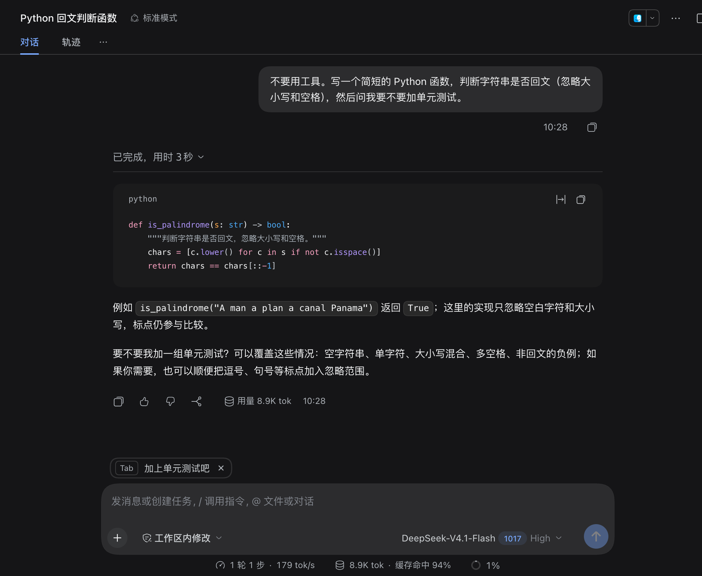
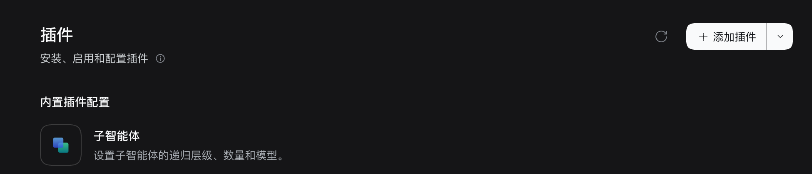
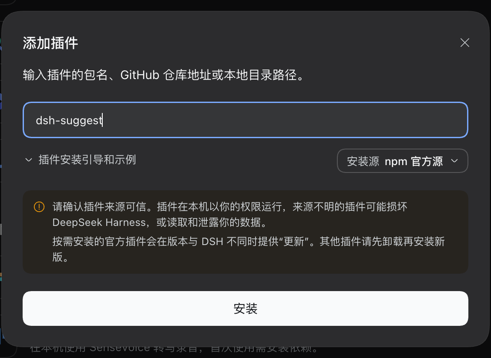
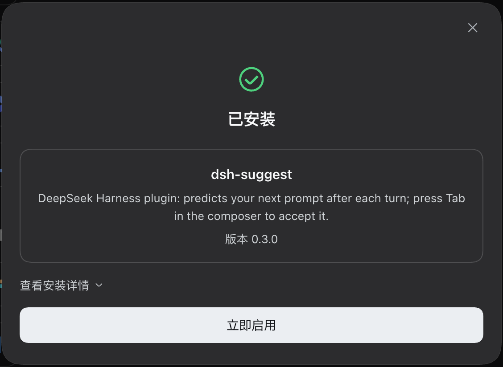
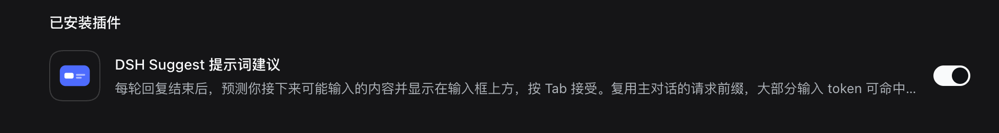
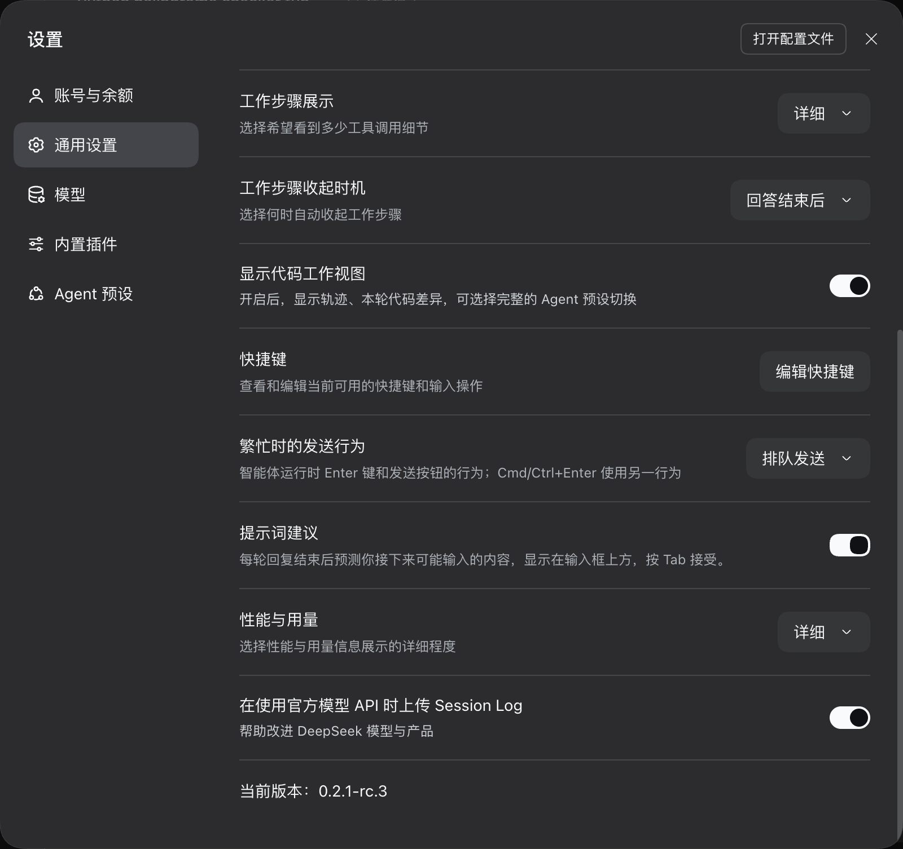

# dsh-suggest

**中文** | [English](README.en.md)

[](https://www.npmjs.com/package/dsh-suggest)

给 DeepSeek Harness 加上类似 Claude Code 的「下一步提示词建议」。每轮回复结束后，插件会预测你接下来可能输入的内容，显示在输入框上方，按 **Tab** 就能填进输入框。



## 功能

- 每轮回复结束后，在输入框上方显示一条预测的下一句，例如「跑一下测试」「加上单元测试吧」。
- 在输入框里按 **Tab**，或点一下提示条，会把建议填进草稿。这次插入可以撤销。
- 点提示条右侧的 **×** 会关闭本轮建议。之后 Tab 恢复原生行为，直到下一轮回复结束。
- 在 **设置 → 通用设置 → 提示词建议** 里可以关闭整个功能（默认开启），切换后立即生效，不用重启。
- 中英文都适用，建议会跟随你的语言和说话风格。

## 安装

需要 DeepSeek Harness **0.2.1-rc.3** 及以上的 0.2.x 版本。插件已发布到 npm：[`dsh-suggest`](https://www.npmjs.com/package/dsh-suggest)。

### 方式一：在 DeepSeek Harness 里添加（推荐）

**1. 打开左侧的「插件」页，点右上角的「添加插件」。**



**2. 输入包名 `dsh-suggest`，点「安装」。** 安装源保持「npm 官方源」即可；访问 npm 慢时，可以在右侧切换到 npmmirror 镜像。



**3. 安装完成后，点「立即启用」。**



**4. 「已安装插件」里出现 DSH Suggest，开关处于打开状态，就可以用了。**



在客户端里安装会立即生效；如果建议没有出现，刷新一下页面或重启客户端。

### 方式二：命令行

```bash
"/Applications/DeepSeek Harness.app/Contents/Resources/runtime/cli/bin/dsh" plugin --profile desktop add dsh-suggest
```

用命令行安装后需要重启客户端。卸载：

```bash
"/Applications/DeepSeek Harness.app/Contents/Resources/runtime/cli/bin/dsh" plugin --profile desktop remove dsh-suggest
```

### 方式三：通过插件市场

1. 打开 **插件** 页，在「实验性插件」里启用 **自定义插件市场**。
2. 在 **发现** 标签页添加索引地址：

   ```
   https://raw.githubusercontent.com/dinjufen/dsh-suggest/main/market.json
   ```

3. 在列表里找到 **DSH Suggest**，点安装。

> 从 0.2.0 升级：0.2.0 的包名是 `dsh-next-prompt`（只在 GitHub 上发布过），0.3.0 起改名为 `dsh-suggest`。请先 `remove dsh-next-prompt`，再按上面的方法安装。注意 npm 上的 `dsh-next-prompt` 是另一位作者的同类插件，不是这个项目。

## 使用

**1. 正常对话。每轮回复结束后，输入框上方会出现一条建议**，就像本页开头的截图那样。

**2. 在输入框里按 Tab（或点一下建议），它就会填进输入框，可以直接发送，也可以先改一改。** 不想要这条建议时，点右侧的 ×。


**3. 想关闭这个功能：左下角头像 → 设置 → 通用设置 → 提示词建议。**



下一步不明显时，模型可能不给建议，这时提示条不会出现。

## 工作原理

- **Host（`index.js`）**：提供一个远程方法 `dshSuggest.suggest({ sessionId })`。它原样复用会话最近一次发给模型的请求头、消息历史、工具定义和 `toolHistory`，只在末尾追加一条预测指令（`suggestion.js`），再用同一个模型请求一次。这次请求最多输出 64 个 token，并使用最低推理强度。请求前缀和主对话逐字一致，所以绝大部分输入 token 能命中 DeepSeek 的上下文缓存，实测约 93%。整个过程不写会话日志，模型下一轮看不到这次请求。
- **过滤（`suggestion.js`）**：先去掉「建议：」前缀、引号和标签，再丢弃以下结果：空回复、评价类（谢谢、不错）、助手口吻（我来、让我）、问句、多句话、超长或带格式的内容。
- **Client（`client.js`）**：提示条挂在 `conversation.input.overlay` slot，看到一轮回复结束时请求一次建议。Tab 用 `ctx.shortcuts.observeFixedInput` 截获，只在这个输入框里、且当前有建议时才生效。设置页那一行挂在 `settings.general.item` slot。
- **设置开关**：`enabled` 是插件配置里的 volatile 字段。设置服务把它写进 profile 的 `cordis.patch.yml`，运行中的插件会立刻读到新值。
- **加载内置包（`shipped.js`）**：插件以 Host 启动脚本所在的安装目录为基准解析 `@deepseek-ai/*` 和 `zod`，并按 `exports` 选 ESM 入口，确保和宿主用的是同一份。

## 配置

可以在 profile 的 `cordis.patch.yml` 里覆盖配置：

```yaml
- id: dsh-suggest
  name: dsh-suggest
  config:
    enabled: true           # 总开关，也可以在 设置 → 通用设置 → 提示词建议 里切换
    maxOutputTokens: 64     # 单次建议的输出上限
    timeoutMs: 20000        # 单次建议的超时（毫秒）
    includeTools: true      # 带上主请求的工具定义，保证前缀一致、缓存命中
    # provider / model      # 可选：改用别的模型（会失去前缀缓存）
    # debug: true           # 在 Host 终端打印每次建议的 token 用量
```

注意：覆盖配置会替换整个 `config`，没写的字段会回落到默认值。

## 已知限制

- 插件基于 DeepSeek Harness 0.2.1-rc.3 的内部接口编写，Typert 清单是手写的。客户端升级后可能需要适配。
- 只有亲眼看到一轮回复结束时才会请求建议。刷新页面或切到旧会话不会触发，以免产生额外费用。
- 同一个会话不能同时在桌面版和 Web 版里打开，这是 DeepSeek Harness 自身的限制。
- 不要和其他同样拦截输入框 Tab 键的提示词建议插件同时安装（例如 npm 上的 `dsh-next-prompt`），它们会抢同一个按键。

## 开发

```bash
git clone https://github.com/dinjufen/dsh-suggest.git
"/Applications/DeepSeek Harness.app/Contents/Resources/runtime/cli/bin/dsh" plugin --profile desktop add "link:$PWD/dsh-suggest"
```

`link:` 安装会直接使用本地目录：改了 `client.js` 刷新页面即可，改了 `index.js` 需要重启客户端。

## License

MIT。`client.js` 内含一份 DeepSeek Harness `remote-info.js` 的拷贝（MIT），详见 [LICENSE](LICENSE)。
